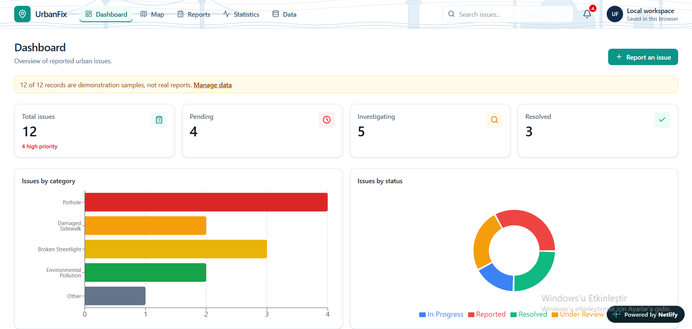
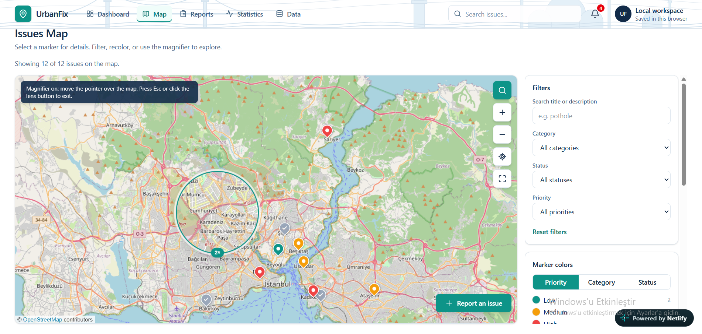
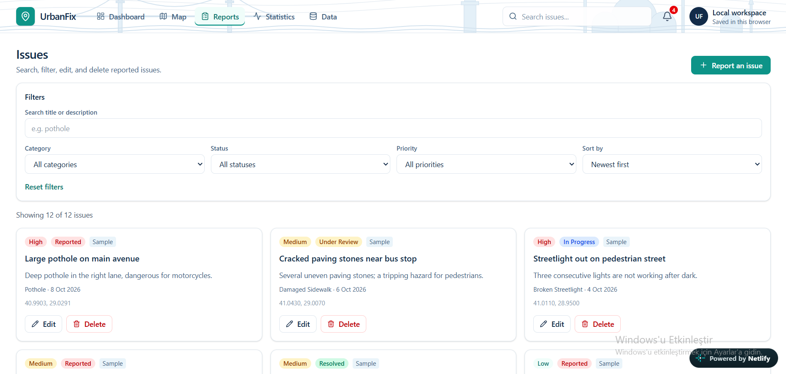
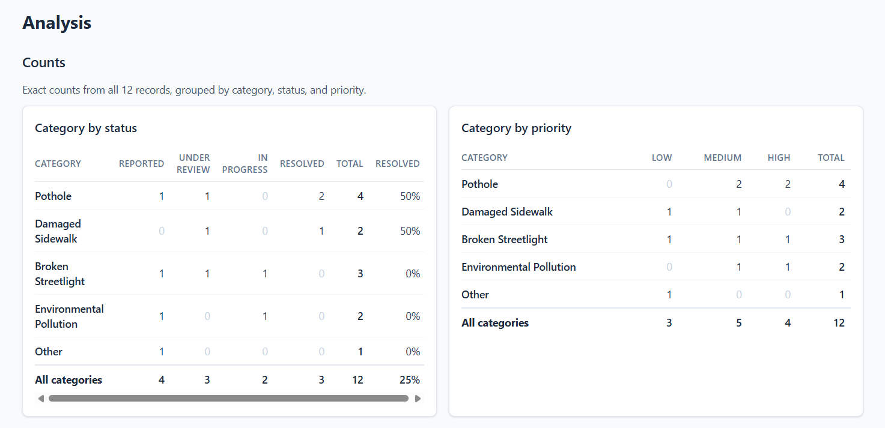
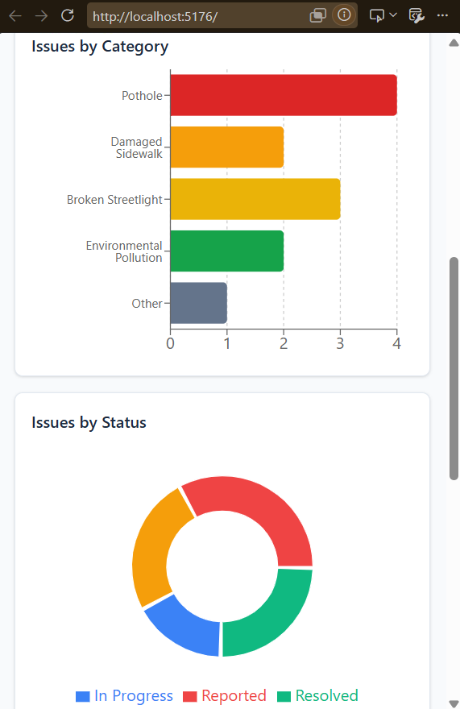

# UrbanFix: Smart Urban Issue Management System

UrbanFix is a web application for reporting and managing urban infrastructure
problems such as potholes, damaged sidewalks, broken streetlights, and
environmental pollution. Locations are picked on an interactive map or detected
with the browser's Geolocation API. The project has a geospatial foundation so
it can later grow into a PostgreSQL/PostGIS and data science project.

**Live demo:** http://localhost:5177/
**Repository:** https://github.com/sevval-k/urbanfix



## Features

**Implemented**

- **Dashboard** with statistics calculated from the actual records (total, pending, investigating, resolved, high priority), a category chart, a status chart, and recent reports
- **Full CRUD** for issues, with form validation, delete confirmation, search by title/description, filters by category, status, and priority, and sorting by date or priority
- **Location picking:** click or tap the map, drag the pin, or use "Use My Current Location" (Geolocation API) with accuracy feedback and graceful handling of denied, unavailable, and timeout errors. Reporting never depends on location detection.
- **Issues map** with markers colored by category, priority, or status, a legend with counts, popups with issue details, and filters
- **Optional reverse geocoding** (button-triggered, cached, rate-limited to respect the Nominatim usage policy)
- **Analysis page:** exact count tables (category by status and priority) and a grid density map showing where reports concentrate
- **Data management:** LocalStorage persistence with safe loading of damaged data, clearly labelled sample records, GeoJSON export, and a PostGIS SQL export
- **Automated tests** (Vitest) for validation, filtering, statistics, storage loading, GeoJSON, density grid, and SQL generation
- Responsive layout for desktop and mobile

**Not implemented (planned only)**

- A backend or database; data lives in the browser
- Formal spatial analysis (hotspot statistics, clustering)
- Any AI or machine learning feature

## Screenshots

| Issues map | Report form |
|---|---|
|  |  |

| Density analysis | Mobile |
|---|---|
|  |  |

## Technologies

- React (Vite), JavaScript, React Router
- Tailwind CSS
- Leaflet, react-leaflet, and OpenStreetMap tiles
- Recharts
- Browser Geolocation API and LocalStorage
- Vitest for tests
- Netlify for hosting

## Getting started

Requires Node.js 20 or newer.

```bash
git clone https://github.com/sevval-k/urbanfix.git
cd urbanfix
npm install
npm run dev
```

Other commands:

```bash
npm test          # run the automated tests
npm run lint      # check code style
npm run build     # production build in dist/
npm run preview   # serve the production build locally
```

Browser geolocation works only on HTTPS or `localhost`.

## Project structure

```
src/
  components/   reusable UI pieces (forms, maps, charts, dialogs)
  pages/        one component per route
  context/      shared issue state and persistence
  hooks/        custom hooks (geolocation, reverse geocoding, issues)
  utils/        pure logic: validation, filtering, stats, density, GeoJSON, SQL
  data/         sample records
docs/           PostGIS migration notes and screenshots
```

Most of the logic sits in pure functions in `utils/`, which is why it is easy to test.

## Data and limitations

- **LocalStorage:** data is stored only in the user's browser on one device. It is not shared between users, devices, or browsers, can be cleared by the user or the browser, and is limited to roughly 5 MB. This is a deliberate first version, not a production design.
- **Sample records** are tagged "Sample" everywhere and can be removed from the Data page.
- **Density map:** a count of reports per square grid cell. It is a visualization, not a statistical hotspot analysis, and it depends on the chosen cell size. Busy areas may simply be where more people report.
- **Geolocation accuracy** varies from a few meters (GPS) to kilometers (IP-based). The app shows the reported accuracy and lets users correct the pin.
- **Reverse geocoding** uses the public Nominatim service, which suits demos but not heavy traffic. It is optional and never blocks reporting.
- **Marker overlap:** reports at the same coordinates overlap on the map (no clustering).
- Photos are stored as links, not uploaded files.

## Database migration

The record shape (flat fields, ISO dates, stable ids, WGS 84 coordinates) was
designed for migration. The Data page exports a SQL script that creates a
PostGIS table with `geometry(Point, 4326)` and loads the records. See
[docs/postgis-migration.md](docs/postgis-migration.md).

## Future improvements

These are ideas only. None is implemented. Each AI feature would need a clearly
defined problem, suitable data, and a proper evaluation method before being built.

- Backend with PostgreSQL/PostGIS, user accounts, and shared data
- Predicting issue priority from historical reports
- Formal spatial analysis (for example kernel density or statistical hotspot tests) with a Python analytics backend
- Forecasting issue volumes once enough history exists
- Image classification to suggest a category from an uploaded photo
- Photo uploads to object storage

## Data attribution

Map tiles and address data &copy; [OpenStreetMap](https://www.openstreetmap.org/copyright) contributors.

## Author

Built by Şevval Köntek as a web development training project, with a Geomatics Engineering focus.